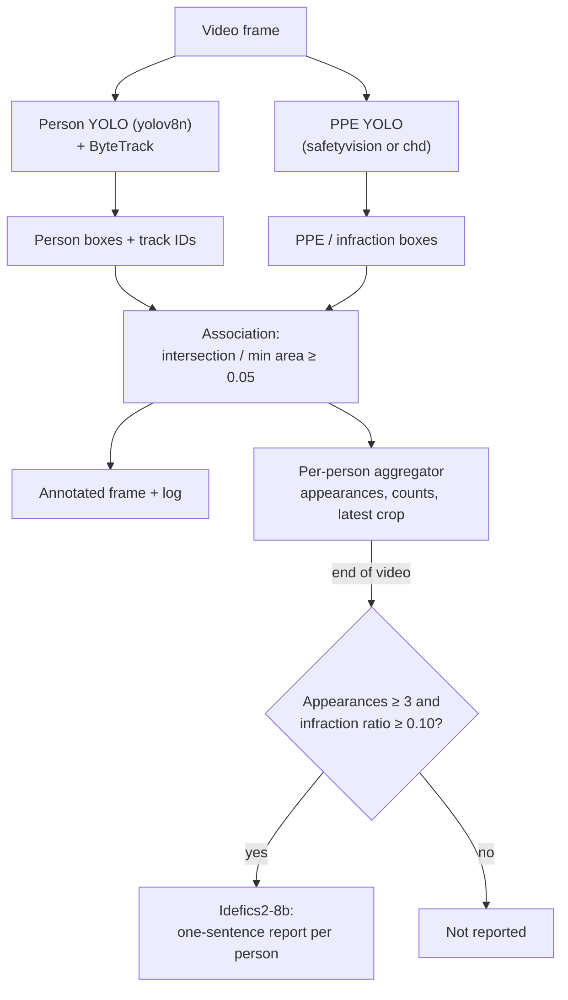

# ppe-compliance-vlm

Video PPE compliance monitoring: YOLO person tracking, PPE infraction detection, per-person consolidation and short vision-language model (VLM) reports in a Streamlit app.

Upload a video, choose which infractions to monitor, and watch an annotated
feed while each tracked person is matched with missing-PPE detections. After
the last frame, persons with consistent infractions are listed in report cards
with their latest crop and a one-sentence description generated by
Idefics2-8b. A headless mode writes the same consolidated report as JSON.


<!-- add a short demo GIF here -->

## Features

- Person detection with YOLOv8n and ByteTrack tracking (stable ids per video).
- Two bundled PPE YOLO models, selectable in the sidebar or with
  `--ppe-model`: `safetyvision` (default, YOLOv8s) and `chd` (YOLO26-L).
- Paired PPE classes per model (worn / missing); the infraction list offered
  in the UI and CLI depends on the selected model.
- Selectable infractions (safetyvision): no-hardhat, no-safety vest,
  no-gloves, no-goggles, no-mask, no_harness, fall-detected
  (chd: no-hardhat, no-safety vest, no-mask).
- Overlap-based association of infraction boxes with persons.
- Live annotated feed (positive PPE in green, infractions in red) and rolling log.
- Per-person consolidation with appearance and ratio thresholds.
- VLM report text per person (lazy-loaded; optional with `--no-vlm`).
- Results cached in the Streamlit session; recomputed when the video,
  PPE model, selected infractions or tracker change.
- Headless `analyze` subcommand that writes a JSON report.
- Selectable tracker config: Ultralytics `bytetrack.yaml` (default) or
  `configs/bytetrack_custom.yaml`.

## How it works



Details, formulas and tuning tips: [docs/how-it-works.md](docs/how-it-works.md).

## Installation

```bash
python -m venv .venv
source .venv/bin/activate        # Windows: .venv\Scripts\activate
pip install -r requirements.txt
pip install -e .
```

For GPU inference install a CUDA build of PyTorch first (see
[pytorch.org](https://pytorch.org/get-started/locally/)).

**GPU note:** Idefics2-8b is an 8-billion-parameter model loaded in fp16 on
CUDA; a large GPU is recommended. On CPU it runs in fp32 and is very slow.
Use `--no-vlm` to run the detection pipeline without it. The PPE weights
are bundled in `weights/`; the first run with the VLM downloads it from
Hugging Face.

## Usage

### Streamlit app

```bash
ppe-compliance                      # launches `streamlit run` on the app
ppe-compliance --no-vlm             # template sentences instead of the VLM
ppe-compliance --ppe-model chd      # preselect the chd model in the sidebar
ppe-compliance --tracker configs/bytetrack_custom.yaml --min-appearances 5
python -m ppe_compliance            # same as ppe-compliance
streamlit run src/ppe_compliance/app.py -- --no-vlm   # direct Streamlit call
```

In the sidebar, select the PPE model, the infractions to monitor (only those
supported by the selected model are offered) and the tracker configuration,
then upload an `.mp4`, `.avi` or `.mov` file.

### Headless analysis

```bash
python -m ppe_compliance analyze --input video.mp4 --output outputs/report.json
python -m ppe_compliance analyze --input video.mp4 --output report.json --no-vlm \
    --infractions no-hardhat "no-safety vest"
python -m ppe_compliance analyze --input video.mp4 --output report.json --ppe-model chd
# also write the annotated video
python -m ppe_compliance analyze --input samples/ppe_demo_input_30s.mp4 --output outputs/report.json \
    --save-video outputs/ppe_demo_annotated.mp4
```

`--infractions` is validated against the selected model; for example
`--ppe-model chd --infractions no-gloves` is rejected.

Run `ppe-compliance --help` and `ppe-compliance analyze --help` for all options.

## Parameters

| Name | Default | Description |
|------|---------|-------------|
| `--person-weights` | `weights/yolov8n.pt` | Person model; falls back to the Ultralytics auto-download by file name |
| `--tracker` | `bytetrack.yaml` | Tracker name or YAML (e.g. `configs/bytetrack_custom.yaml`); also in the sidebar |
| `--ppe-model` | `safetyvision` | Bundled PPE model: `safetyvision` or `chd` (also in the sidebar) |
| `--min-appearances` | `3` | Minimum frames with an infraction for a person to be reported |
| `--min-ratio` | `0.10` | Minimum `count / appearances` for an infraction label |
| `--vlm-model` | `HuggingFaceM4/idefics2-8b` | VLM used for the report text |
| `--no-vlm` | off | Use the template sentence instead of the VLM |
| `--infractions` (analyze) | all supported by the model | Infractions to monitor (sidebar in the app) |
| `--input` / `--output` (analyze) | required | Input video / output JSON |

Fixed defaults in `src/ppe_compliance/config.py`: person `conf=0.35`,
`iou=0.20`, class `0`; PPE `conf=0.25`, `iou=0.20`, `imgsz` from the model
registry (896 for safetyvision, 640 for chd); overlap threshold `0.05`;
VLM greedy decoding, `max_new_tokens=60`, `repetition_penalty=1.5`.

## Output

**App:** annotated live feed, progress bar, rolling log (last 20 lines), the
metrics *Persons with infractions* and *Total consolidated infractions*
(sum of kept labels over persons), and one report card per person with the
latest crop, the kept infraction labels and the VLM text.

**JSON (`analyze`):** no images are stored.

```json
{
  "input": "video.mp4",
  "frames_processed": 900,
  "monitored_infractions": ["no-hardhat", "..."],
  "settings": {"ppe_model": "safetyvision", "tracker": "bytetrack.yaml", "min_appearances": 3, "min_ratio": 0.1},
  "persons_with_infractions": 1,
  "total_consolidated_infractions": 2,
  "persons": [
    {
      "person_id": 4,
      "appearances": 37,
      "infractions": ["no-hardhat", "no-safety vest"],
      "infraction_counts": {"no-hardhat": 35, "no-safety vest": 12},
      "description": "...",
      "description_source": "HuggingFaceM4/idefics2-8b"
    }
  ],
  "note": "Model outputs; human review required before any decision."
}
```

(Values above illustrate the format only.)

## Project structure

```
ppe-compliance-vlm/
  configs/bytetrack_custom.yaml   # optional tracker config
  docs/how-it-works.md
  src/ppe_compliance/
    __init__.py  __main__.py
    cli.py          # entry point: launches Streamlit or runs `analyze`
    app.py          # Streamlit UI
    analyze.py      # headless JSON report
    pipeline.py     # video loop shared by app and analyze
    detector.py     # PPEDetector: models, tracking, association, drawing
    association.py  # box overlap (stdlib)
    aggregation.py  # PersonInfractionAggregator (stdlib)
    drawing.py      # OpenCV drawing / image conversion
    vlm.py          # VLMReporter (lazy Idefics2 loading)
    models.py       # PPE model registry and paired class mapping (stdlib)
    config.py       # dataclass defaults and path helpers (stdlib)
  tests/            # tests for the pure-logic modules
  weights/          # yolov8n.pt, safetyvision_v2_yolov8s.pt, chd_yolo26l.pt + README
```

Run the tests with `pytest` (they only need the standard library).

## Limitations

- Detections, tracks and associations are model outputs and can be wrong
  (missed or false PPE detections, id switches, infractions assigned to a
  nearby person). Every result needs human review.
- The VLM text can be wrong or hallucinated, and the prompt includes the
  detector's labels, so it tends to agree with them. It must not be used as
  the sole evidence for disciplinary or other decisions about workers; human
  review is required.
- The available infractions depend on the classes of the selected PPE model:
  `chd` has no gloves, goggles, harness or fall classes.
- Positive classes (e.g. `Hardhat`) are only drawn for context; compliance is
  inferred only from negative classes (e.g. `NO-Hardhat`). A missed negative
  detection means no infraction is reported.
- The `safetyvision` author reports `NO-Safety Vest` as its weakest class and
  advises not to rely on it alone for vest compliance; `Mask` / `NO-Mask` are
  also reported as weak.
- `appearances` counts only frames with an infraction, so the ratio is
  relative to those frames, not to the time a person is visible.
- Track ids are not re-identification: a person who leaves and re-enters may
  get a new id and appear in several reports.
- Processing is sequential and frame by frame; long videos take time,
  especially without a GPU.
- No accuracy evaluation has been done for this project.

## Models & credits

### PPE models

Both PPE models are stored in `weights/` and selected with `--ppe-model` or
in the sidebar. Class names are matched in lower case; the pairing used by
this project is defined in `src/ppe_compliance/models.py`.

| | `safetyvision` (default) | `chd` |
|---|---|---|
| File | `weights/safetyvision_v2_yolov8s.pt` (22 MB) | `weights/chd_yolo26l.pt` (51 MB) |
| Architecture | YOLOv8s | YOLO26-L |
| Inference `imgsz` | 896 | 640 |
| PPE pairs (worn / missing) | Hardhat / NO-Hardhat, Safety Vest / NO-Safety Vest, Gloves / NO-Gloves, Goggles / NO-Goggles, Mask / NO-Mask, – / No_Harness | Hardhat / NO-Hardhat, Safety Vest / NO-Safety Vest, Mask / NO-Mask |
| Other infractions | Fall-Detected | – |
| Ignored classes | Person | Person, Safety Cone, machinery, utility pole, vehicle |
| Reported metric* | test mAP50 0.766, mAP50-95 0.487 (imgsz 896, 4,026 test images) | validation mAP50-95 0.6482 (imgsz 640, 6,664 validation images) |
| License | AGPL-3.0 | AGPL-3.0 |
| Source | [ayushgupta7777/safetyvision-yolov8](https://huggingface.co/ayushgupta7777/safetyvision-yolov8) (`v2/best.pt`) | [yihong1120/Construction-Hazard-Detection](https://huggingface.co/yihong1120/Construction-Hazard-Detection) (`models/yolo26/pt/yolo26l.pt`), code on [GitHub](https://github.com/yihong1120/Construction-Hazard-Detection) |

\* As reported by each author on their own split. The numbers come from
different datasets and splits, are not comparable with each other and have
not been validated in this project.

Person tracking always uses `weights/yolov8n.pt`; the `Person` class of the
PPE models is ignored.

### Other credits

- [Ultralytics YOLO](https://github.com/ultralytics/ultralytics) (YOLOv8,
  YOLO26) and its ByteTrack integration — AGPL-3.0.
- [Idefics2-8b](https://huggingface.co/HuggingFaceM4/idefics2-8b) by Hugging
  Face — Apache-2.0.

See [weights/README.md](weights/README.md) for files, sizes and checksums.

## License

AGPL-3.0, because the project uses Ultralytics YOLO (AGPL-3.0).
