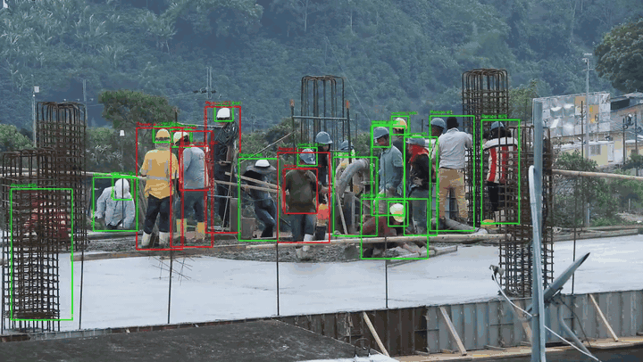
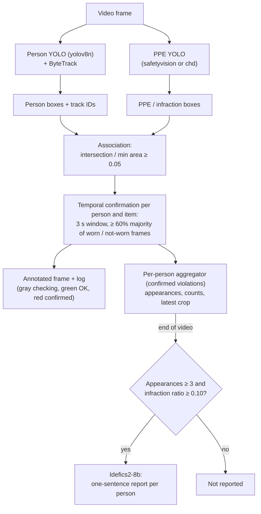

# ppe-compliance-vlm

Video PPE compliance monitoring: YOLO person tracking, PPE infraction detection, per-person consolidation and short vision-language model (VLM) reports in a Streamlit app.

Upload a video, choose which infractions to monitor, and watch an annotated
feed while each tracked person is matched with worn / missing PPE detections.
A person only turns red after a few seconds in which most frames show the
item missing, and back to green after a few seconds in which most frames
show it worn. After the last frame, persons with confirmed infractions are
listed in report cards
with their latest crop and a one-sentence description generated by
Idefics2-8b. A headless mode writes the same consolidated report as JSON.


<!-- add a short demo GIF here -->

## Features

- Person detection with YOLOv8n and ByteTrack tracking (stable ids per video).
- Two bundled PPE YOLO models, selectable in the sidebar or with
  `--ppe-model`: `safetyvision` (default, YOLOv8s) and `chd` (YOLO26-L).
- Paired PPE classes per model (worn / missing); the infraction list offered
  in the UI and CLI depends on the selected model.
- Selectable infractions (safetyvision): no-hardhat, no-safety vest,
  no-gloves, no-goggles, no-mask, no_harness, fall-detected
  (chd: no-hardhat, no-safety vest, no-mask).
- Overlap-based association of PPE and infraction boxes with persons.
- Temporal confirmation (hysteresis) per person and item: a sliding-window
  majority vote filters flickering and single-frame noise.
- Live annotated feed (person gray while checking, green when OK, red with
  the confirmed violations; raw PPE boxes in thin green / red) and rolling log.
- Per-person consolidation of confirmed violations with appearance and ratio
  thresholds.
- VLM report text per person (lazy-loaded; optional with `--no-vlm`).
- Results cached in the Streamlit session; recomputed when the video,
  PPE model, selected infractions or tracker change.
- Headless `analyze` subcommand that writes a JSON report.
- Selectable tracker config: Ultralytics `bytetrack.yaml` (default) or
  `configs/bytetrack_custom.yaml`.

## How it works



Details, formulas and tuning tips: [docs/how-it-works.md](docs/how-it-works.md).

### Temporal confirmation

Detections flicker: in some frames the person or the PPE item is not found,
and a single frame can disagree with its neighbors. So the person box does not
follow individual frames. For every tracked person and PPE item, each frame
is read as *worn* (e.g. `Hardhat` on the person), *not worn* (e.g.
`NO-Hardhat`) or *unknown* (neither; if both, the higher confidence wins).
Event classes such as `Fall-Detected` only have a *not worn* side.

- Nothing changes until the person has been tracked for `--confirm-seconds`
  (3 s); the box is gray (`#id checking`).
- Over the last 3 s, if at least 30% of the frames are informative (worn or
  not worn) and at least 60% of those say *not worn*, the item becomes a
  **violation** (red). If 60% say *worn*, it becomes **OK** (green).
- Otherwise the previous state is kept. Unknown frames never flip a state, so
  a short burst of contradicting frames is ignored.
- A track unseen for 2 s is forgotten.

Reports and the JSON count only frames with a confirmed violation.

## Installation

```bash
python -m venv .venv
source .venv/bin/activate        # Windows: .venv\Scripts\activate
pip install -r requirements.txt
pip install -e .
```

For GPU inference install a CUDA build of PyTorch first (see
[pytorch.org](https://pytorch.org/get-started/locally/)).

**GPU note:** Idefics2-8b is an 8-billion-parameter model loaded in fp16 on
CUDA; a large GPU is recommended. On CPU it runs in fp32 and is very slow.
Use `--no-vlm` to run the detection pipeline without it. The PPE weights
are bundled in `weights/`; the first run with the VLM downloads it from
Hugging Face.

## Results

Example run on [`samples/ppe_demo_input.mp4`](samples/README.md) (four real-time Pexels clips:
construction site, warehouse aisle, industrial structure, lumber warehouse; 1,598 frames, ~53 s)
with the default `safetyvision` model, person `conf=0.45`, `--no-vlm`, on CPU (about 7 minutes):

| File | Content |
|---|---|
| [`results/ppe_demo_safetyvision.mp4`](results/ppe_demo_safetyvision.mp4) | Annotated video (720p, **played at 1.5× speed**; processing ran at the original speed): person boxes in red when an infraction is associated, PPE items in green, infractions in red. |
| [`results/report_safetyvision.json`](results/report_safetyvision.json) | Consolidated report: 24 tracked IDs with infractions (23 × NO-Safety Vest, 8 × NO-Hardhat, 2 × NO-Goggles). |

The GIF at the top shows the industrial-structure segment.

These files were produced before the temporal confirmation was added (person
boxes followed each frame, `ppe_conf` 0.25); a run with the current version
will differ.

Observations from this run (qualitative, not a validated evaluation):

- Industrial structure: the worker with hardhat and vest stays green; the worker without a vest is flagged `NO-Safety Vest`. Missing gloves on the first worker are not flagged.
- Construction site: hardhats are detected on most workers; missing vests are flagged on part of them. The person model (`yolov8n`, 640 px) finds about 7–9 of the ~20 workers per frame, so some workers are never checked.
- Warehouse aisle: one worker without a hardhat is not flagged, and a shelf in the foreground is detected as a person (confidence up to 0.57).
- Lumber warehouse: the spotter's vest is detected; the forklift operator (no vest, no hardhat) is not flagged.
- Tracker ID switches inflate the per-person count.

## Usage

### Streamlit app

```bash
ppe-compliance                      # launches `streamlit run` on the app
ppe-compliance --no-vlm             # template sentences instead of the VLM
ppe-compliance --ppe-model chd      # preselect the chd model in the sidebar
ppe-compliance --tracker configs/bytetrack_custom.yaml --min-appearances 5
python -m ppe_compliance            # same as ppe-compliance
streamlit run src/ppe_compliance/app.py -- --no-vlm   # direct Streamlit call
```

In the sidebar, select the PPE model, the infractions to monitor (only those
supported by the selected model are offered) and the tracker configuration,
then upload an `.mp4`, `.avi` or `.mov` file.

### Headless analysis

```bash
python -m ppe_compliance analyze --input video.mp4 --output outputs/report.json
python -m ppe_compliance analyze --input video.mp4 --output report.json --no-vlm \
    --infractions no-hardhat "no-safety vest"
python -m ppe_compliance analyze --input video.mp4 --output report.json --ppe-model chd
# also write the annotated video
python -m ppe_compliance analyze --input samples/ppe_demo_input.mp4 --output outputs/report.json \
    --save-video outputs/ppe_demo_annotated.mp4
```

`--infractions` is validated against the selected model; for example
`--ppe-model chd --infractions no-gloves` is rejected.

Run `ppe-compliance --help` and `ppe-compliance analyze --help` for all options.

## Parameters

| Name | Default | Description |
|------|---------|-------------|
| `--person-weights` | `weights/yolov8n.pt` | Person model; falls back to the Ultralytics auto-download by file name |
| `--person-conf` | `0.45` | Confidence threshold for person detections; raise it if non-persons are detected |
| `--ppe-conf` | `0.15` | Confidence threshold for PPE / infraction detections (low on purpose; the temporal rule filters noise) |
| `--tracker` | `bytetrack.yaml` | Tracker name or YAML (e.g. `configs/bytetrack_custom.yaml`); also in the sidebar |
| `--ppe-model` | `safetyvision` | Bundled PPE model: `safetyvision` or `chd` (also in the sidebar) |
| `--confirm-seconds` | `3.0` | Sliding window (s); also the time a track must exist before its state can change |
| `--min-majority` | `0.6` | Share of informative frames (worn + not worn) the winning side needs, in (0.5, 1] |
| `--min-coverage` | `0.3` | Minimum share of informative frames in the window; below it the state is kept |
| `--lost-seconds` | `2.0` | Forget a track's history after it is unseen this long |
| `--min-frames` | `5` | Minimum informative frames in the window before a state can change |
| `--min-appearances` | `3` | Minimum frames with a confirmed infraction for a person to be reported |
| `--min-ratio` | `0.10` | Minimum `count / appearances` (confirmed frames) for an infraction label |
| `--vlm-model` | `HuggingFaceM4/idefics2-8b` | VLM used for the report text |
| `--no-vlm` | off | Use the template sentence instead of the VLM |
| `--infractions` (analyze) | all supported by the model | Infractions to monitor (sidebar in the app) |
| `--input` / `--output` (analyze) | required | Input video / output JSON |

Other fixed defaults in `src/ppe_compliance/config.py`: person
`iou=0.20`, class `0`; PPE `iou=0.20`, `imgsz` from the model
registry (896 for safetyvision, 640 for chd); overlap threshold `0.05`;
VLM greedy decoding, `max_new_tokens=60`, `repetition_penalty=1.5`.

## Output

**App:** annotated live feed (person boxes gray / green / red as described
in *Temporal confirmation*), progress bar, rolling log (last 20 lines), the
metrics *Persons with infractions* and *Total consolidated infractions*
(sum of kept labels over persons), and one report card per person with the
latest crop, the kept infraction labels and the VLM text.

**JSON (`analyze`):** no images are stored.

```json
{
  "input": "video.mp4",
  "frames_processed": 900,
  "monitored_infractions": ["no-hardhat", "..."],
  "settings": {"ppe_model": "safetyvision", "tracker": "bytetrack.yaml", "min_appearances": 3, "min_ratio": 0.1,
               "ppe_conf": 0.15,
               "temporal": {"window_seconds": 3.0, "min_majority": 0.6, "min_coverage": 0.3, "lost_seconds": 2.0}},
  "persons_with_infractions": 1,
  "total_consolidated_infractions": 2,
  "persons": [
    {
      "person_id": 4,
      "appearances": 37,
      "infractions": ["NO-Hardhat", "NO-Safety Vest"],
      "infraction_counts": {"NO-Hardhat": 35, "NO-Safety Vest": 12},
      "description": "...",
      "description_source": "HuggingFaceM4/idefics2-8b"
    }
  ],
  "note": "Model outputs; human review required before any decision."
}
```

(Values above illustrate the format only.) `appearances` and
`infraction_counts` are numbers of frames in which the violation was
confirmed by the temporal rule.

## Project structure

```
ppe-compliance-vlm/
  configs/bytetrack_custom.yaml   # optional tracker config
  docs/how-it-works.md
  src/ppe_compliance/
    __init__.py  __main__.py
    cli.py          # entry point: launches Streamlit or runs `analyze`
    app.py          # Streamlit UI
    analyze.py      # headless JSON report
    pipeline.py     # video loop shared by app and analyze
    detector.py     # PPEDetector: models, tracking, per-person observations
    association.py  # box overlap and per-item observations (stdlib)
    temporal.py     # temporal confirmation / hysteresis (stdlib)
    aggregation.py  # PersonInfractionAggregator (stdlib)
    drawing.py      # OpenCV drawing / image conversion
    vlm.py          # VLMReporter (lazy Idefics2 loading)
    models.py       # PPE model registry and paired class mapping (stdlib)
    config.py       # dataclass defaults and path helpers (stdlib)
  tests/            # tests for the pure-logic modules
  weights/          # yolov8n.pt, safetyvision_v2_yolov8s.pt, chd_yolo26l.pt + README
```

Run the tests with `pytest` (they only need the standard library).

## Limitations

- Detections, tracks and associations are model outputs and can be wrong
  (missed or false PPE detections, id switches, infractions assigned to a
  nearby person). Every result needs human review.
- The VLM text can be wrong or hallucinated, and the prompt includes the
  detector's labels, so it tends to agree with them. It must not be used as
  the sole evidence for disciplinary or other decisions about workers; human
  review is required.
- The available infractions depend on the classes of the selected PPE model:
  `chd` has no gloves, goggles, harness or fall classes.
- Positive and negative classes are both needed: an item missed by the
  model in most frames stays *unknown* and the person stays gray or keeps
  its last state. Harness and fall events have no positive class: they can
  never become OK, and once confirmed they stay red until the track is lost
  (unseen for `--lost-seconds`) or gets a new id.
- A false detection that is stable over seconds (e.g. a low-confidence
  `NO-Goggles` on every frame) is confirmed like a real one; the temporal
  rule only removes short, inconsistent noise. The low `ppe_conf` (0.15)
  lets more of these through.
- The association threshold is low, so a PPE box of a nearby person can
  count for the wrong person in crowded scenes.
- The confirmed state lags the scene by up to `--confirm-seconds`.
- The `safetyvision` author reports `NO-Safety Vest` as its weakest class and
  advises not to rely on it alone for vest compliance; `Mask` / `NO-Mask` are
  also reported as weak.
- `appearances` counts only frames with a confirmed infraction, so the
  ratio is relative to those frames, not to the time a person is visible.
- Track ids are not re-identification: a person who leaves and re-enters may
  get a new id and appear in several reports.
- Processing is sequential and frame by frame; long videos take time,
  especially without a GPU.
- No accuracy evaluation has been done for this project.

## Models & credits

### PPE models

Both PPE models are stored in `weights/` and selected with `--ppe-model` or
in the sidebar. Class names are matched in lower case; the pairing used by
this project is defined in `src/ppe_compliance/models.py`.

| | `safetyvision` (default) | `chd` |
|---|---|---|
| File | `weights/safetyvision_v2_yolov8s.pt` (22 MB) | `weights/chd_yolo26l.pt` (51 MB) |
| Architecture | YOLOv8s | YOLO26-L |
| Inference `imgsz` | 896 | 640 |
| PPE pairs (worn / missing) | Hardhat / NO-Hardhat, Safety Vest / NO-Safety Vest, Gloves / NO-Gloves, Goggles / NO-Goggles, Mask / NO-Mask, – / No_Harness | Hardhat / NO-Hardhat, Safety Vest / NO-Safety Vest, Mask / NO-Mask |
| Other infractions | Fall-Detected | – |
| Ignored classes | Person | Person, Safety Cone, machinery, utility pole, vehicle |
| Reported metric* | test mAP50 0.766, mAP50-95 0.487 (imgsz 896, 4,026 test images) | validation mAP50-95 0.6482 (imgsz 640, 6,664 validation images) |
| License | AGPL-3.0 | AGPL-3.0 |
| Source | [ayushgupta7777/safetyvision-yolov8](https://huggingface.co/ayushgupta7777/safetyvision-yolov8) (`v2/best.pt`) | [yihong1120/Construction-Hazard-Detection](https://huggingface.co/yihong1120/Construction-Hazard-Detection) (`models/yolo26/pt/yolo26l.pt`), code on [GitHub](https://github.com/yihong1120/Construction-Hazard-Detection) |

\* As reported by each author on their own split. The numbers come from
different datasets and splits, are not comparable with each other and have
not been validated in this project.

Person tracking always uses `weights/yolov8n.pt`; the `Person` class of the
PPE models is ignored.

### Other credits

- [Ultralytics YOLO](https://github.com/ultralytics/ultralytics) (YOLOv8,
  YOLO26) and its ByteTrack integration — AGPL-3.0.
- [Idefics2-8b](https://huggingface.co/HuggingFaceM4/idefics2-8b) by Hugging
  Face — Apache-2.0.

See [weights/README.md](weights/README.md) for files, sizes and checksums.

## License

AGPL-3.0, because the project uses Ultralytics YOLO (AGPL-3.0).
