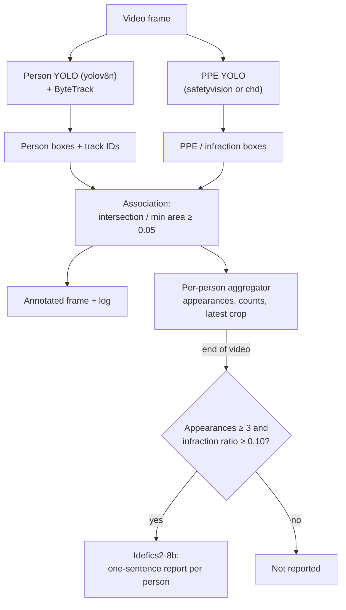

# How it works

The pipeline has two phases: a per-frame detection phase while the video
plays, and a consolidation + description phase after the last frame.



## 1. Person tracking

`yolov8n.pt` runs with `track(..., classes=[0], conf=0.45, iou=0.20,
tracker="bytetrack.yaml", persist=True)`. `persist=True` keeps the tracker
state between frames so ids are stable. The tracker is reset when a new video
(or new settings) is processed, so ids start again for each video. Frames in
which ByteTrack returns no ids contribute no persons.

## 2. PPE detection

### Model selection

Two PPE models are bundled in `weights/` and registered in
`src/ppe_compliance/models.py` as `PPEModelSpec` entries (key, display name,
weights path, source, license, `imgsz` and class mapping). The model is
chosen with `--ppe-model {safetyvision,chd}` (default `safetyvision`) or in
the Streamlit sidebar; the app keeps one loaded detector per model.

The selected model runs on the full frame with `conf=0.25, iou=0.20` and the
model's `imgsz` (896 for `safetyvision`, as recommended by its model card;
640 for `chd`, the size used on its model card).

### Paired classes

For each PPE item the registry stores a *positive* class (item worn) and a
*negative* class (item missing), either of which may be absent:

| PPE item | `safetyvision` (worn / missing) | `chd` (worn / missing) |
|----------|----------------------------------|------------------------|
| Hardhat | Hardhat / NO-Hardhat | Hardhat / NO-Hardhat |
| Safety vest | Safety Vest / NO-Safety Vest | Safety Vest / NO-Safety Vest |
| Gloves | Gloves / NO-Gloves | – |
| Safety goggles | Goggles / NO-Goggles | – |
| Mask | Mask / NO-Mask | Mask / NO-Mask |
| Harness | – / No_Harness | – |

Extra infractions not tied to an item: `Fall-Detected` (`safetyvision`
only). Ignored classes: `Person` (both; persons come from the tracker) and
`Safety Cone`, `machinery`, `utility pole`, `vehicle` (`chd`).

The infraction labels are the lower-case negative / extra class names
(`no-hardhat`, `no-safety vest`, `no-gloves`, `no-goggles`, `no-mask`,
`no_harness`, `fall-detected`). The sidebar and `--infractions` only offer
the labels supported by the selected model (`chd`: `no-hardhat`,
`no-safety vest`, `no-mask`).

Each detection is classified by its lower-case class name:

- **Infraction** — a negative or extra infraction class of the model **and**
  selected by the user. Drawn in red.
- **Positive PPE** — a positive class of the model. Drawn in green, for
  context only; it does not cancel an infraction.
- Anything else (ignored classes, unselected infractions) is skipped.

When a model is loaded, its class names are compared with the registry and a
warning is logged for missing or unexpected names.

## 3. Association

An infraction box `I` is associated with a person box `P` when

```
ratio = area(I ∩ P) / min(area(I), area(P)) >= 0.05
```

Dividing by the smaller area (instead of the union, as IoU does) gives 1.0
when a small infraction box lies fully inside the person box. The threshold is
deliberately low, so an infraction near overlapping persons can be assigned to
more than one of them. A person with at least one associated infraction is
drawn red and contributes one *frame infraction* (track id, labels, crop).

## 4. Aggregation and selection

For each track id the aggregator keeps:

- `appearances` — number of frames in which the person had **at least one**
  associated infraction (frames where the person is compliant are not
  counted);
- `ppe_counts[label]` — number of frames with that label;
- `latest_crop` — person crop from the most recent such frame.

After the video, a person is reported when

```
appearances >= min_appearances            (default 3)
ppe_counts[label] / appearances >= min_ratio   (default 0.10, per label)
```

and only the labels passing the ratio are listed. Because `appearances`
counts only infraction frames, the ratio measures how often a label occurs
among a person's infraction frames, not among all frames the person is
visible. The `appearances` threshold filters out short, flickering false
positives; the ratio removes labels that appear only sporadically next to a
persistent one.

## 5. VLM report

For each reported person, the latest crop and the kept labels are sent to
`HuggingFaceM4/idefics2-8b` with the prompt:

```
User: <image> Analyze this industrial worker. The detection system flagged the
following missing PPE: {labels}. Confirm or explain this safety infraction
briefly in one direct sentence.
Assistant:
```

Decoding is greedy (`do_sample=False`, `num_beams=1`), `max_new_tokens=60`,
`repetition_penalty=1.5`. If the output is shorter than 3 characters, a
template sentence is used instead. The model is loaded on first use (fp16 on
CUDA, fp32 on CPU). With `--no-vlm`, the template sentence is always used.

The prompt tells the model which labels were flagged, so the answer tends to
agree with the detector; it is a description, not an independent check.

## Parameter guide

| Parameter | Default | Effect of increasing |
|-----------|---------|----------------------|
| person `conf` | 0.45 | fewer person detections, fewer false persons |
| person `iou` | 0.20 | NMS keeps more overlapping person boxes |
| PPE `conf` | 0.25 | fewer PPE / infraction boxes |
| PPE `iou` | 0.20 | NMS keeps more overlapping PPE boxes |
| overlap threshold | 0.05 | stricter infraction-to-person association |
| `min_appearances` | 3 | fewer, more persistent reports |
| `min_ratio` | 0.10 | fewer labels per report |

Only the tracker, the person weights, the PPE model, the report thresholds
and the VLM model are exposed on the command line; the other values
live in the dataclasses of `src/ppe_compliance/config.py`.

## Tuning tips

- **Ids switch often / one worker gets several ids:** try
  `--tracker configs/bytetrack_custom.yaml` (longer `track_buffer`). Its very
  low thresholds only take effect if the person `conf` is lowered too, because
  detections below `conf` never reach the tracker.
- **Infractions assigned to the wrong person in crowded scenes:** raise the
  overlap threshold (e.g. 0.3–0.5) in `DetectorConfig`.
- **Too many short-lived reports:** raise `--min-appearances`.
- **Slow processing:** the two YOLO models run on every frame; a GPU helps.
  `chd` (YOLO26-L) is larger than `safetyvision` (YOLOv8s), but
  `safetyvision` runs at `imgsz` 896.
- **Gloves, goggles, harness or falls needed:** only `safetyvision` has these
  classes. Its author reports `NO-Safety Vest` as weak; do not rely on it
  alone for vest compliance.
  The VLM runs only once per reported person at the end.
