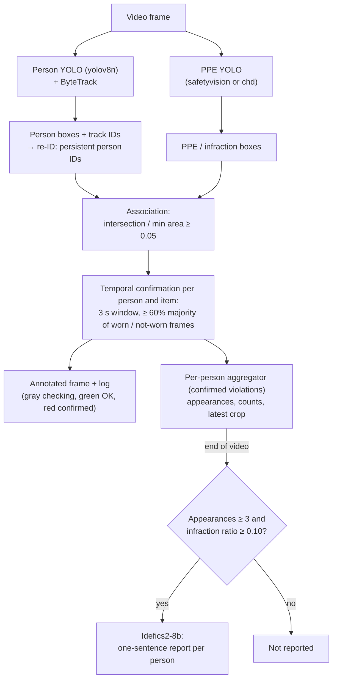

# How it works

The pipeline has two phases: a per-frame detection phase while the video
plays, and a consolidation + description phase after the last frame.



## 1. Person tracking

`yolov8n.pt` runs with `track(..., classes=[0], conf=0.45, iou=0.20,
tracker="bytetrack.yaml", persist=True)`. `persist=True` keeps the tracker
state between frames so ids are stable. The tracker is reset when a new video
(or new settings) is processed, so ids start again for each video. Frames in
which ByteTrack returns no ids contribute no persons.

### Re-identification

Implemented in `src/ppe_compliance/reid.py` (standard library only) and
`src/ppe_compliance/appearance.py` (embedders), applied in
`pipeline.process_video`. A tracker id is not a person: ByteTrack gives a new
id when a person leaves and re-enters, after a long occlusion or after an id
switch. The re-identifier maps every tracker id to a persistent **person id**
(1, 2, ... in order of creation). The temporal rule (section 4), the drawn
label `#id` and the aggregation (section 5) use the person id.

**Embeddings.** For a person box `P` of height `h`, an embedding is computed
only if `h ≥ 64` px and no other person box covers more than 30% of `P`
(`area(P ∩ Q) / area(P) ≤ 0.3`), so partial and occluded crops do not enter
the gallery. Embedders (`--reid-embedder`):

- `histogram` (default): the crop is resized to 64×128, converted to HSV and
  split into 6 horizontal stripes; per stripe a 16×4 hue-saturation histogram
  and an 8-bin value histogram are L1-normalized and square-rooted, then
  concatenated and L2-normalized (cosine = averaged Bhattacharyya coefficient).
- any other value: Ultralytics weights (e.g. `yolo11n-cls.pt`), whose pooled
  features (`YOLO.embed`, imgsz 224) are L2-normalized. Batched per frame; runs
  on the GPU when available.

**Matching.** A new tracker id is *pending* until it has `min_samples = 3`
embeddings or `0.5 s` have passed (drawn thin gray, `track N re-id...`, not
fed to the temporal rule). Let `q` be the normalized mean of its embeddings
and `g(p)` the normalized mean of the gallery of person `p`. Candidates are
the persons whose last frame is **before** the first frame of the new track
(a person visible at the same time is someone else) and, if
`--reid-max-absence` > 0, unseen for at most that long. With
`s(p) = cos(q, g(p))`, best `s₁` and second best `s₂`:

```
reuse argmax s(p)   if s₁ ≥ threshold (0.85) and s₁ − s₂ ≥ margin (0.03)
new person id       otherwise (also when the track has no embedding)
```

Each person keeps its 30 most recent embeddings, at most one every 0.2 s;
embeddings are computed only for pending tracks and for persons whose gallery
is due for a sample. If two boxes map to the same person in one frame, only the
first is fed to the temporal rule and the aggregator.

`--no-reid` restores the previous behavior (person id = tracker id).

## 2. PPE detection

### Model selection

Two PPE models are bundled in `weights/` and registered in
`src/ppe_compliance/models.py` as `PPEModelSpec` entries (key, display name,
weights path, source, license, `imgsz` and class mapping). The model is
chosen with `--ppe-model {safetyvision,chd}` (default `safetyvision`) or in
the Streamlit sidebar; the app keeps one loaded detector per model.

The selected model runs on the full frame with `conf=0.15, iou=0.20` and the
model's `imgsz` (896 for `safetyvision`, as recommended by its model card;
640 for `chd`, the size used on its model card). The confidence is low on
purpose: isolated low-confidence boxes are filtered by the temporal rule
(section 4) instead of being dropped per frame.

### Paired classes

For each PPE item the registry stores a *positive* class (item worn) and a
*negative* class (item missing), either of which may be absent:

| PPE item | `safetyvision` (worn / missing) | `chd` (worn / missing) |
|----------|----------------------------------|------------------------|
| Hardhat | Hardhat / NO-Hardhat | Hardhat / NO-Hardhat |
| Safety vest | Safety Vest / NO-Safety Vest | Safety Vest / NO-Safety Vest |
| Gloves | Gloves / NO-Gloves | – |
| Safety goggles | Goggles / NO-Goggles | – |
| Mask | Mask / NO-Mask | Mask / NO-Mask |
| Harness | – / No_Harness | – |

Extra infractions not tied to an item: `Fall-Detected` (`safetyvision`
only). Ignored classes: `Person` (both; persons come from the tracker) and
`Safety Cone`, `machinery`, `utility pole`, `vehicle` (`chd`).

The infraction labels are the lower-case negative / extra class names
(`no-hardhat`, `no-safety vest`, `no-gloves`, `no-goggles`, `no-mask`,
`no_harness`, `fall-detected`). The sidebar and `--infractions` only offer
the labels supported by the selected model (`chd`: `no-hardhat`,
`no-safety vest`, `no-mask`).

Each detection is classified by its lower-case class name:

- **Infraction** — a negative or extra infraction class of the model **and**
  selected by the user. Drawn in red.
- **Positive PPE** — a positive class of the model. Drawn in green and
  used as evidence that the item is worn (section 4).
- Anything else (ignored classes, unselected infractions) is skipped.

When a model is loaded, its class names are compared with the registry and a
warning is logged for missing or unexpected names.

## 3. Association

A PPE or infraction box `I` is associated with a person box `P` when

```
ratio = area(I ∩ P) / min(area(I), area(P)) >= 0.05
```

Dividing by the smaller area (instead of the union, as IoU does) gives 1.0
when a small box lies fully inside the person box. The threshold is
deliberately low, so a box near overlapping persons can be assigned to more
than one of them. Both positive (e.g. `Hardhat`) and negative (e.g.
`NO-Hardhat`) boxes are associated; for each person and item the result is
one observation per frame (section 4).

## 4. Temporal confirmation (hysteresis)

Implemented in `src/ppe_compliance/temporal.py` (standard library only) and
applied in `pipeline.process_video`.

### Observations

For each frame, tracked person `p` and monitored item `k` (one per negative
class of the model, plus event classes such as `Fall-Detected`), let
`c⁺` and `c⁻` be the highest confidences of the positive and negative boxes
of `k` associated with `p` (absent = none). The observation is

```
o(p, k) = WORN       if c⁺ present and (c⁻ absent or c⁺ > c⁻)
          NOT_WORN   if c⁻ present and (c⁺ absent or c⁻ ≥ c⁺)
          UNKNOWN    otherwise
```

A tie counts as NOT_WORN. Items without a positive class (`No_Harness`,
`Fall-Detected`) can only be NOT_WORN or UNKNOWN.

### Rule

Frame time is `t = (frame_index - 1) / fps` (`CAP_PROP_FPS`, 30 if the
container does not report one). For each (person, item) the tracker keeps
the observations with time in `[t - W, t]` and running counts:

```
n   = frames of the person in the window
n⁺  = WORN frames,  n⁻ = NOT_WORN frames,  m = n⁺ + n⁻ (informative)
```

After adding the frame at time `t`, with `t₀` the first time the track was seen:

```
if t - t₀ < W:                     keep state (not present long enough)
elif m < min_frames or m / n < min_coverage: keep state (too little evidence)
elif n⁻ / m ≥ min_majority:          state = VIOLATION
elif n⁺ / m ≥ min_majority:          state = OK
else:                                keep state
```

The initial state is UNKNOWN. `min_majority` must be in `(0.5, 1]`, so
both sides cannot win at once. UNKNOWN frames only lower the coverage, they
never flip a state. Each update appends one entry and evicts the entries
older than `t - W`, so it costs O(1) amortized.

The person state is VIOLATION if any item is VIOLATION, OK if at least one
item is OK and none is VIOLATION, UNKNOWN otherwise. The box is drawn gray
(`#id checking`), green (`#id OK`) or red with the confirmed violation
labels (e.g. `#3 NO-Hardhat`). Raw PPE boxes are still drawn, with thin
lines (green positive, red negative).

A person unseen for more than `lost_seconds` is forgotten (pruned every
frame); if the same person id comes back later (same tracker id, or a new one
re-identified as that person) it starts again as UNKNOWN. A person who is
re-identified within `lost_seconds` keeps its state.

Example at the defaults (`W = 3 s`, 30 fps, ~91 frames per window): a
person consistently detected with `NO-Hardhat` turns red 3 s after first
being tracked. Once red, at least 60% of the informative frames in the last
3 s must show `Hardhat` before it turns green; a burst of a few `Hardhat`
frames changes nothing.

### Parameters

| Parameter | CLI | Default | Meaning |
|-----------|-----|---------|---------|
| `window_seconds` (`W`) | `--confirm-seconds` | 3.0 | window length and minimum track age before any change |
| `min_majority` | `--min-majority` | 0.6 | share of informative frames the winning side needs |
| `min_coverage` | `--min-coverage` | 0.3 | minimum `m / n`; below it the state is kept |
| `lost_seconds` | `--lost-seconds` | 2.0 | gap after which a track's history is dropped |
| `min_frames` | `--min-frames` | 5 | minimum informative frames `m` in the window before any change |

## 5. Aggregation and selection

The aggregator receives, per frame, the **confirmed** violations of each
person (the items in state VIOLATION after section 4), not the raw
detections. For each person id it keeps:

- `appearances` — number of frames in which the person had **at least one**
  confirmed violation (other frames are not counted);
- `ppe_counts[label]` — number of frames with that label;
- `latest_crop` — person crop from the most recent such frame (and, per
  label, the crop of the most recent frame with that label);
- `track_ids` — tracker ids merged into the person (listed in the report).

After the video, a person is reported when

```
appearances >= min_appearances            (default 3)
ppe_counts[label] / appearances >= min_ratio   (default 0.10, per label)
```

and only the labels passing the ratio are listed. Because `appearances`
counts only confirmed-violation frames, the ratio measures how often a label
is confirmed among those frames, not among all frames the person is visible.
Flicker is already removed by the temporal rule, so with the defaults these
thresholds mostly drop tracks that were confirmed for only a few frames
before being lost.

The app processes the video once with all items and filters the report by
the selected infractions afterwards (`select_reports(labels=...)`, case
insensitive); the report crop is then the latest one of a frame with a
selected label. Items are confirmed independently, so this equals processing
with that filter.

## 6. VLM report

For each reported person, the latest crop and the kept labels are sent to
`HuggingFaceM4/idefics2-8b` (or the model given with `--vlm-model`, e.g.
`HuggingFaceTB/SmolVLM-500M-Instruct` on CPU) with the instruction:

```
This is a cropped image of an industrial worker. The detection system flagged
the following missing PPE: {labels}. Double-check the image and answer in one
short sentence whether you confirm the missing PPE or not.
```

If the processor has a chat template, the prompt is built with
`apply_chat_template` from one user message holding the image and this text,
with the generation prompt appended. Otherwise the Idefics2-style string
`User: <image> {instruction}\nAssistant:` is used. Only the newly generated
tokens are decoded, and any `Assistant:` prefix is removed.

Decoding is greedy (`do_sample=False`, `num_beams=1`), `max_new_tokens=60`,
`repetition_penalty=1.5`. If the output is shorter than 3 characters, a
template sentence is used instead. The model is loaded on first use (fp16 on
CUDA, fp32 on CPU). With `--no-vlm`, the template sentence is always used.

The prompt tells the model which labels were flagged, so the answer tends to
agree with the detector; it is a description, not an independent check.

## Parameter guide

| Parameter | Default | Effect of increasing |
|-----------|---------|----------------------|
| person `conf` | 0.45 | fewer person detections, fewer false persons |
| person `iou` | 0.20 | NMS keeps more overlapping person boxes |
| PPE `conf` | 0.15 | fewer PPE / infraction boxes, more UNKNOWN frames |
| PPE `iou` | 0.20 | NMS keeps more overlapping PPE boxes |
| overlap threshold | 0.05 | stricter box-to-person association |
| `--confirm-seconds` | 3.0 | slower, more stable state changes |
| `--min-majority` | 0.6 | stricter: more agreement needed to change state |
| `--min-coverage` | 0.3 | more evidence needed; more persons stay gray |
| `--lost-seconds` | 2.0 | history kept across longer occlusions |
| `min_appearances` | 3 | fewer, more persistent reports (confirmed frames) |
| `min_ratio` | 0.10 | fewer labels per report |
| `--reid-threshold` | 0.85 | fewer merges: fewer wrong merges, more persons split into several ids |
| `--reid-margin` | 0.03 | ambiguous matches more often get a new id |
| `--reid-max-absence` | 0 (whole video) | when > 0, persons absent longer are not matched |

Only the tracker, the person weights and confidence, the PPE model and its confidence, the
temporal rule, the report thresholds and the VLM model are exposed on the
command line; the other values live in the dataclasses of
`src/ppe_compliance/config.py` and `src/ppe_compliance/temporal.py`.

## Tuning tips

- **One worker gets several person ids:** lower `--reid-threshold`
  (e.g. 0.75–0.8) or try `--reid-embedder yolo11n-cls.pt`; check the log
  lines `Track N is new person #M (best similarity ...)`.
- **Different workers merged into one person (same `track_ids` list for
  two people):** raise `--reid-threshold` (e.g. 0.9) or `--reid-margin`, or
  set `--reid-max-absence`. Uniform PPE makes workers look alike.
- **Ids switch often:** try
  `--tracker configs/bytetrack_custom.yaml` (longer `track_buffer`). Its very
  low thresholds only take effect if the person `conf` is lowered too, because
  detections below `conf` never reach the tracker.
- **Infractions assigned to the wrong person in crowded scenes:** raise the
  overlap threshold (e.g. 0.3–0.5) in `DetectorConfig`.
- **Too many short-lived reports:** raise `--min-appearances`.
- **Persons turn red on doubtful evidence:** raise `--min-majority` (e.g.
  0.75–0.8) or `--confirm-seconds`; raising `--ppe-conf` back to 0.25 also
  removes steady low-confidence false detections, which the temporal rule
  cannot filter.
- **Small, distant or occluded persons stay gray:** their PPE is detected in
  few frames; lower `--min-coverage` (e.g. 0.1–0.2).
- **Feedback too slow:** lower `--confirm-seconds` (e.g. 1.5); short noise
  bursts then have more weight.
- **State lost after short occlusions:** raise `--lost-seconds` (the tracker
  must also keep the same id, see the first tip).
- **Slow processing:** the two YOLO models run on every frame; a GPU helps.
  `chd` (YOLO26-L) is larger than `safetyvision` (YOLOv8s), but
  `safetyvision` runs at `imgsz` 896. The VLM runs only once per reported
  person at the end.
- **Gloves, goggles, harness or falls needed:** only `safetyvision` has these
  classes. Its author reports `NO-Safety Vest` as weak; do not rely on it
  alone for vest compliance.
